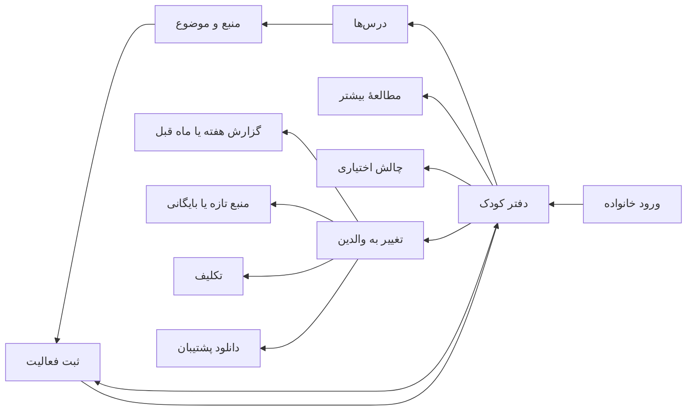

# وایرفریم‌ها و نقشهٔ مسیر

[بازکردن وایرفریم‌ها](index.html) • سطح جزئیات: ساختار و ترتیب عناصر، بدون ادعای طراحی نهایی • مبنا: PRD و رابط موجود

| نما | ساختار و عمل اصلی | نیازمندی |
|---|---|---|
| WF-01 ورود | نشانه و نام ← توضیح فضای خانواده ← رمز و خطا ← ورود | REQ-01 |
| WF-02 دفتر کودک | سربرگ/انتخاب بخش ← ناوبری ← ثبت فعالیت ← تکلیف ← خط زمان ← چالش و پیش‌نمایش آینده | REQ-02,04,06,07,08 |
| WF-03 درس‌ها و منبع | شبکهٔ درس‌ها ← تب منابع مستقل ← فصل و موضوع ← ثبت فعالیت | REQ-03,05,09 |
| WF-04 فرم فعالیت | درس/منبع ← موضوع ← تاریخ ← یادداشت اختیاری ← تکمیل ← ثبت/انصراف | REQ-04,05,12 |
| WF-05 نمای والدین | نمای کلی منابع ← تکلیف/منبع جدید ← تکلیف‌های پیش رو ← نوشته‌های اخیر | REQ-02,06,09 |
| WF-06 گزارش | انتخاب هفته/ماه ← بازهٔ کامل ← شمارش‌های جدا ← جدول درس ← نوشته‌ها | REQ-10 |
| WF-07 پشتیبان | توضیح زمان تصویر ← فهرست تاریخ/اندازه ← دانلود خصوصی | REQ-11 |

در موبایل ناوبری چهارستونی افقی بالای محتوا قرار می‌گیرد، فرم تک‌ستونی و محتوای جانبی پس از محتوای اصلی می‌آید. دکمهٔ اصلی ثبت داخل محتوای کودک باقی می‌ماند؛ دکمهٔ شناور نوار کناری در موبایل پنهان است.

تغییر بخش در نمودار، عبور از مرز امنیتی نیست. کنترل‌های درون وایرفریم صرفاً نمایشی‌اند؛ فقط انتخاب نما و اندازه کار می‌کند. طراحی دقیق و تصاویر منطبق با کد در [گالری رابط](../../design/app-web-design/index.html) هستند.
