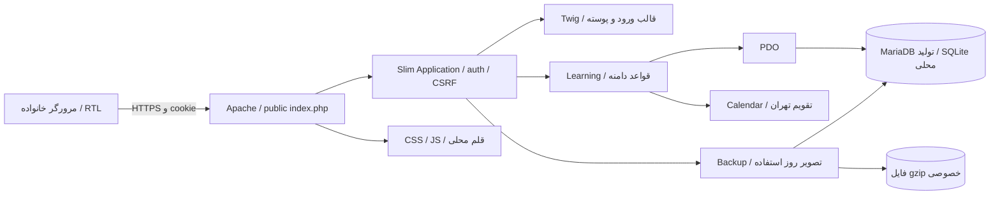
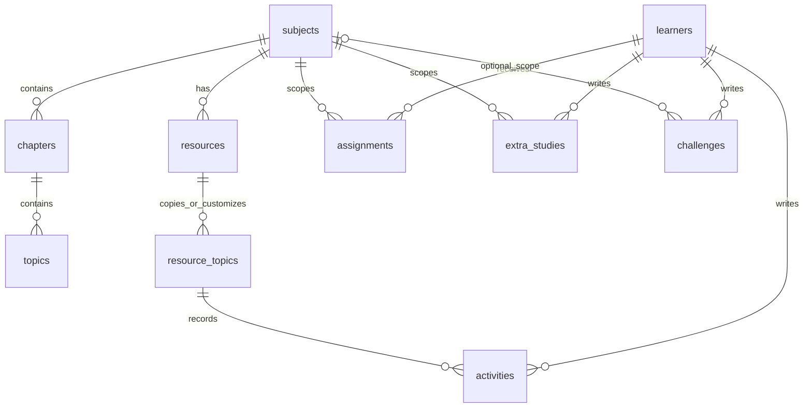

# معماری نرم‌افزار کشف

وضعیت: معماری موجود در ۲۸ مهر ۱۴۰۵ • ورودی: [PRD](../product/PRD.md) و [طراحی رابط](../design/app-web-design/README.md)

## زمینه و اجزا

یک برنامهٔ یکپارچهٔ PHP برای یک خانواده و یک یادگیرنده. Slim 4 مسیر و middleware، Twig 3 پوستهٔ HTML، Alpine CSP راه‌اندازی state رابط، JavaScript ماژولی نمایش دفتر و PDO داده را مدیریت می‌کنند. MariaDB پایگاه تولید و SQLite ابزار محلی/آزمون است. وابستگی سرویس AI، پرداخت، صف، Cron یا سرویس analytics در اجرای نسخهٔ حاضر وجود ندارد.

| جزء | مسئولیت | منبع |
|---|---|---|
| Application | راه‌اندازی، route، نشست، CSRF، خطا و header | [Application.php](../../src/Application.php) |
| Learning | state، اعتبارسنجی، فعالیت، تکلیف، منابع و گزارش | [Learning.php](../../src/Learning.php) |
| Database | PDO، schema و نصب catalog | [Database.php](../../src/Database.php) |
| Calendar | ارقام ورودی، شمسی/میلادی، بازه‌های قبل | [Calendar.php](../../src/Calendar.php) |
| Backup | snapshot تراکنشی، gzip، نگه‌داری ۷ فایل و restore | [Backup.php](../../src/Backup.php) |
| journal | فراخوانی API، render و فرم‌ها؛ state خوانده‌شده از سرور | [journal.js](../../resources/journal.js) |
| report-view | نمایش بازهٔ قبلی از state دریافتی | [report-view.js](../../resources/report-view.js) |
| Vite | ساخت JS/CSS/قلم؛ manifest برای یافتن assets | [vite.config.js](../../vite.config.js) |

## مرزهای اعتماد و جریان داده

۱. ورودی عمومی فقط فایل‌های `public/` است. تنظیم، vendor، کد و storage باید بیرون ریشهٔ وب باشند.

۲. نشست PHP سمت سرور است. رمز مشترک با `password_verify` بررسی و شناسهٔ نشست پس از ورود عوض می‌شود. محدودیت ورود کلید HMAC از IP و app_key دارد؛ IP خام در جدول login_attempts ذخیره نمی‌شود. Cookie در تولید Secure، HttpOnly و SameSite=Lax است.

۳. state با GET خوانده می‌شود؛ اولین خواندن روز ممکن است بکاپ بسازد. درخواست نوشتن نشست، CSRF و بخش مناسب می‌خواهد. نقش child/parent در همان نشست قابل تغییر است و مرز مجوز میان اشخاص نیست.

۴. پس از ثبت موفق، رابط state را دوباره می‌خواند و پیشرفت از دادهٔ سرور محاسبه می‌شود. sessionStorage فقط انتخاب نما را نگه می‌دارد. نوشتن در localStorage یا حالت آفلاین وجود ندارد.

۵. Twig autoescape و تابع escape رابط متن کاربر را امن نمایش می‌دهند. PDO پارامتری مقادیر را می‌فرستد؛ identifierها در Database::insert بررسی می‌شوند. ممیزی مستقل امنیتی انجام نشده است.

## مدل داده

| موجودیت | کلید/قید مهم | رفتار |
|---|---|---|
| schema_versions | version | نصب نسخهٔ ۱ را مشخص می‌کند؛ موتور migration عمومی نیست |
| learners | id | نسخهٔ فعلی فقط id=1 را نصب و استفاده می‌کند |
| subjects/chapters/topics | شناسه‌های catalog و position | ترتیب و سرفصل اولیه |
| resources | UNIQUE(subject_id, resource_key) | منبع متعلق به درس، archived حفظ سابقه |
| resource_topics | UNIQUE(resource_id, topic_key) | کپی موضوع catalog یا موضوع اختصاصی |
| activities | FK resource_topic_id و learner_id | تاریخ انجام، note، kind، completed و deleted_at؛ حذف عمومی عرضه نشده |
| assignments | learner، subject، due_date و completed_at | تکلیف مستقل از پیشرفت؛ archived در مدل داده |
| extra_studies | entry_date و reference_text | تاریخ در ویرایش ثابت |
| challenges | subject_id اختیاری | null معادل روزمره؛ تاریخ در ویرایش ثابت |
| login_attempts | ip_key | محدودیت تلاش ورود؛ جزو بکاپ یادگیری نیست |

پیشرفت جدول جدا ندارد؛ از فعالیت‌های حذف‌نشدهٔ کامل، کلید متمایز `(subject,source,topic)` استخراج می‌شود. این انتخاب از drift میان فعالیت و شمارنده جلوگیری می‌کند، ولی همهٔ state از DB خوانده می‌شود و با افزایش رکورد هزینه دارد. صفحه‌بندی سروری و شاخص کارایی در نسخهٔ حاضر تعریف نشده‌اند.

`resource_topics` هنگام ایجاد منبع کپی می‌شود؛ تغییر آیندهٔ catalog منابع موجود را خودکار همگام نمی‌کند. بکاپ ۱۱ جدول دامنه را طبق `Backup::TABLES` می‌گیرد؛ نشست‌ها و login_attempts در آن نیستند. DB schema مجموعاً ۱۲ جدول دارد.

## قرارداد API v1

پیشوند همهٔ مسیرها `/api/v1` است. JSON UTF-8 و نشست معتبر لازم است؛ نوشتن با هدر `X-CSRF-Token`. child/parent در این جدول بخش فعلی نشست است.

| مسیر / روش | بخش | ورودی اصلی | نتیجه |
|---|---|---|---|
| GET /state | هر دو | ندارد | state شامل catalog، resources، logs، tasks، extras، challenges، completions، ranges و backupWarning |
| POST /context | هر دو | role=child یا parent | state بخش تازه |
| POST /activities | child | subject, source, topic, date, note?, complete?, kind?, task? | 201 و id |
| PUT /activities/{id} | child | همان ورودی | 200 و id |
| POST/PUT /assignments[/{id}] | parent | subject, title, description?, due | 201/200 و id |
| POST /assignments/{id}/complete | child | complete | 200 و ok |
| POST/PUT /extra-studies[/{id}] | child | subject, title, report, date, reference? | 201/200 و id؛ تاریخ ویرایش نادیده گرفته می‌شود |
| POST/PUT /challenges[/{id}] | child | subject یا general، title, report, date | 201/200 و id؛ تاریخ اصلی ثابت |
| POST /resources | parent | subject, title, shared؛ اگر false، topics چندخطی | 201 و id عددی DB |
| POST /resources/{id}/archive | parent | شناسهٔ DB در مسیر | 200 و ok |
| GET /reports?period=week یا month | parent | بازه | range و رکوردهای فیلترشده |
| GET /backups | parent | ندارد | files با name, bytes, date |
| GET /backups/{name} | parent | نام استاندارد kashf-YYYY-MM-DD.json.gz | فایل application/gzip |

شناسهٔ `resources[].id` کلید متنی منبع است، مانند school یا custom-16؛ `database_id` عددی برای بایگانی استفاده می‌شود. state شناسهٔ فعالیت و تکلیف را رشته می‌فرستد. رابط گزارش فعلی از state و `report-view.js` استفاده می‌کند؛ API مستقل `/reports` نیز موجود و آزموده‌شده در شواهد قبلی است.

ورود با POST `/login` و فرم password/_csrf است؛ موفقیت 303 به `/`. خروج POST `/logout` و CSRF است. خطاهای معمول: 401 بدون نشست، 403 بخش نامناسب، 419 CSRF، 422 اعتبارسنجی، 429 محدودیت ورود، 404 مسیر و 500 خطای عمومی. پیدا نشدن بعضی رکوردهای دامنه در Learning به‌صورت 422 برمی‌گردد. unavailable در نبود تنظیم معتبر/اتصال، 503 دارد.

## تقویم، سازگاری و عملیات

زمان ثبت فنی UTC و روز/مرز گزارش تهران است. تاریخ رخداد DATE میلادی و نمایش فارسی است. تاریخ آینده فقط برای موعد تکلیف مجاز است. مرز هفته شنبه/جمعه و ماه شمسی قبل از Calendar گرفته می‌شود.

بکاپ از snapshot داده در تراکنش، قفل فایل، فایل موقت و rename استفاده می‌کند. هفت نسخهٔ روزهای استفاده نگه می‌ماند؛ snapshot روز یک‌بار ساخته می‌شود. مقدار RPO ثابت ۲۴ساعت تضمین نمی‌شود: روزهای بی‌استفاده بکاپ ندارند و خرابی storage یا وقفهٔ استفاده فاصله را زیاد می‌کند. RTO اندازه‌گیری نشده است.

در تولید، طبق شواهد ثبت‌شده، PHP 8.2.30 و MariaDB 10.1.48 استفاده شده‌اند؛ این سند بررسی زندهٔ دوباره انجام نداده است. وابستگی‌های دقیق در lockها هستند. هدف اجرای PHP با نیازمندی Composer یعنی `^8.2` سازگار است؛ اشارهٔ PHP 8.4 در راهنمای قدیمی restore یک ناسازگاری مستنداتی ثبت‌شده در TASK-02 است.

محدودیت‌ها: نبود کنترل هم‌زمانی و idempotency، بدون pagination سروری، بدون محدودیت اندازهٔ قابل اندازه‌گیری برای دفتر بلندمدت، بدون مانیتورینگ فعال و بدون تمدید خودکار TLS تأییدشده. تصمیم‌ها و راه بعدی: [technical-decisions](technical-decisions.md)، [backlog](tasks/backlog.md).
